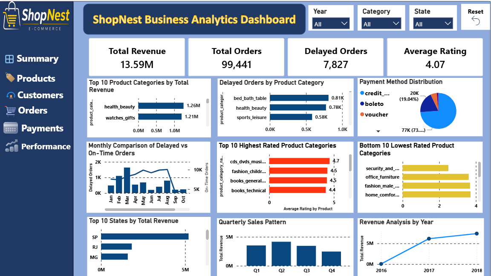

# ShopNest E-Commerce Business Analytics Dashboard

## Project Overview
ShopNest is an e-commerce business analytics project developed using Microsoft Power BI. The project analyzes e-commerce sales, product categories, customer ratings, payment preferences, regional performance, and delivery operations to generate meaningful business insights.

The dashboard provides interactive filters for Year, Category, and State, allowing users to explore business performance dynamically.

## Dashboard Preview

## Key Performance Indicators (KPIs)

| KPI | Result |
|---|---:|
| Total Revenue | 13.59M |
| Total Orders | 99,441 |
| Delayed Orders | 7,827 |
| Average Rating | 4.07 |

## Business Questions & Analysis

This project addresses eight key business questions:

1. **Top Product Categories by Revenue:** Identified the highest revenue-generating product categories.
2. **Delayed Orders by Category:** Analyzed delivery delays across product categories.
3. **Monthly Delivery Performance:** Compared delayed and on-time orders by month.
4. **Payment Method Analysis:** Examined customer payment preferences.
5. **Product Ratings Analysis:** Identified the highest and lowest-rated product categories.
6. **State-wise Sales Analysis:** Compared revenue performance across states.
7. **Quarterly Sales Pattern:** Analyzed seasonal sales trends across quarters.
8. **Yearly Revenue Analysis:** Evaluated revenue trends over time.

## Key Business Insights

- Health Beauty generated the highest category revenue at approximately 1.26 million.
- Watches Gifts ranked second with approximately 1.21 million in revenue.
- Bed Bath Table recorded the highest number of delayed orders, at approximately 810.
- Credit Card was the most frequently used payment method, accounting for approximately 74% of transactions.
- São Paulo (SP) recorded the highest state-wise revenue.
- Quarter 2 recorded the highest quarterly sales at approximately 4.1 million.
- Revenue increased from 2016 to 2018.

## Tools & Technologies

- Microsoft Power BI
- Power Query
- Data Modeling
- DAX
- Data Visualization
- Excel / CSV datasets

## Dashboard Features

- Interactive Year,
